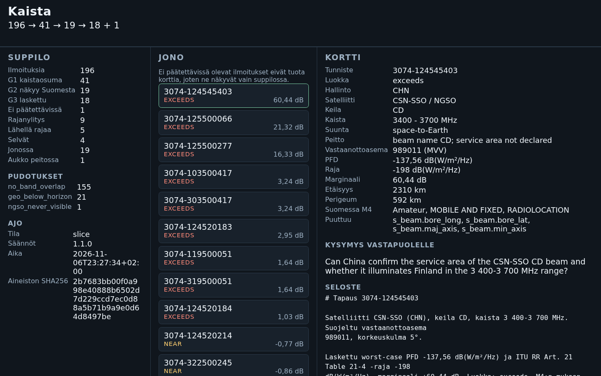

# Kaista: IFIC triage for the Finnish frequency register

Since AI Hackathon 2026 · Challenge: Traficom, "Saving Earth from Space Interferers Using Radio
Frequencies" · Team: Greedy Decoding (Janne Rosama, solo)

## The problem

Every two weeks the ITU publishes a BR IFIC with hundreds of new satellite filings. A Traficom
specialist has to find the ones that can touch Finnish radio use, check them against the Finnish
frequency register, and write to the administration behind them. Space IFIC 3074 alone holds 196
notices and 95 865 frequency rows, and the check is done by hand.

## What this does

A deterministic triage pipeline that shows its work. It reads one IFIC package, derives the
protected bands from Traficom's table of frequencies of interest, keeps the space-to-Earth notices
that overlap those bands and can be seen from Finland, and computes an upper-bound power flux
density (PFD) against the ITU Radio Regulations Article 21, Table 21-4 limit.

Every notice that survives the gates and gets a number becomes a case card with the source rows,
the calculation, the Finnish allocation from Regulation M4, the missing data, and one question for
the other administration. A notice that passes G1 and G2 but cannot be computed is not a card: it
keeps its row in `queue.md` and `3074_results.csv` under class `cannot_decide`, and its count is in
`funnel.json`. The demo slice therefore has 18 cards and one notice without (limitation 15). The
queue shows the most urgent cards, capped at 20. A separate accuracy file covers all 196 notices,
the dropped ones included. A human decides.

The language model only writes the card summary. Every number comes from code, and a numeric guard
rejects a sentence that carries a number the card does not have. The correspondence letter has its
own template and function and is covered by tests, but the CLI does not write letters to `out/`.

A side feature applies the same style to terrestrial land-mobile notices: it diffs two
3076-style extracts, filters what is within 1 000 km of Finland and overlaps the register, and
computes ITU-R P.1546-6 field strength at four Finnish test points.



The screenshot above is the demo slice after the run: the funnel, the queue of 18 cards and the
selected card 124545403.

## Verified numbers

Measured 7 Nov 2026 on IFIC 3074: `make check` 116 tests passed, the slice run takes about 1.3 s,
the seven-band run about 5.5 s. The deterministic pipeline is offline; the optional LLM prose step
is the only part that opens a connection, and only when `LLM_BASE_URL` is set.

| | Demo slice 3 470–3 780 MHz | All seven space bands (`--all`) |
|---|---|---|
| Notices in | 196 | 196 |
| Register stations on the bands | 7 | 84 |
| Protected bands | 2 (1 group) | 26 (7 groups) |
| G1 band overlap | 41 | 101 |
| G2 visible from Finland | 19 (16 GEO, 3 non-GSO) | 75 |
| G3 computed | 18 | 64 |
| cannot_decide | 1 (`no_power`) | 11 |
| exceeds / near / clear | 9 / 5 / 4 | 26 / 15 / 23 |
| Queue | 19 shown, coverage gap 1 | 20 shown, overflow 6 / 15 / 11 / 23 |

Two test vectors reproduce to the digit:

| Notice | PFD | Table 21-4 limit | Margin | Elevation | Slant range |
|---|---|---|---|---|---|
| 103500417 | −184,78 dB(W/m²/Hz) | −188,02 | +3,24 dB | 4,85° | 41 143 km |
| 124545403 | −137,56 dB(W/m²/Hz) | −198,00 | +60,44 dB | 5,0° | 2 310 km |

The seven-band funnel sits one notice above the plan (101 / 75 / 11 against 100 / 74 / 10). The
reference tool behind the plan read the register cell `0,1G` as 0.1 MHz; this code reads the
`Channel bandwidth` column as 0.1 GHz = 100 MHz. The demo slice is identical in both. The reason
is written up in `docs/decisions.md`, and `tests/test_gates.py::test_all_bands_funnel` locks the
numbers in this repository.

The terrestrial side feature on the committed synthetic fixture reports 3 new, 1 modified,
1 withdrawn, 12 notices in reach.

## Run it

Prerequisites: [uv](https://docs.astral.sh/uv/), `make`, and `mdbtools` for `mdb-export`.

```bash
sudo apt install mdbtools                 # mdb-export reads the IFIC Access database
uv sync                                   # creates .venv from uv.lock
cp <path>/Traficom_SinceAI_Frequencies_of_interest_v05112026.xlsx data/   # from the Since AI platform
uv run python scripts/fetch_data.py       # downloads IFIC 3074 and the M4 table, converts everything to CSV
```

`fetch_data.py` prints a SHA256 for every file it writes. Both source URLs answered on 6 Nov 2026
with the browser-style user agent the script sends; if ITU serves its challenge page instead of the
zip, the script stops with a clear error instead of writing a broken file.

```bash
# the demo: the 3.47-3.78 GHz slice, six files into out/
uv run python -m app.pipeline --ific data/itu-ific-3074 \
  --register data/frequencies_of_interest.csv \
  --m4 data/taajuusjakotaulukko.json --out out/

# the whole register: all seven space bands
uv run python -m app.pipeline --ific data/itu-ific-3074 \
  --register data/frequencies_of_interest.csv \
  --m4 data/taajuusjakotaulukko.json --out out/ --all

# the terrestrial side feature (two extracts, one issue per file)
uv run python -m app.terrestrial --prev prev.json --curr curr.json \
  --register data/frequencies_of_interest.csv --out out/

# the web UI over whatever the last run wrote
uv run uvicorn app.main:app --reload      # http://localhost:8000
```

`sh scripts/demo.sh` is the slice run plus the two files worth showing. `docs/demo.md` has the
three-minute script and the two commands that split the terrestrial fixture into one issue per
file.

The deterministic pipeline is offline. The LLM is an optional extra step: without `LLM_BASE_URL`
every card falls back to the deterministic template in `templates/`, and the run opens no
connection at all. With `LLM_BASE_URL` set, `app/prose.py` makes one request per card to that
endpoint through `app/llm.py`. `scripts/fetch_data.py` remains the only code that downloads
anything, and only when called by hand.

### Output files

| File | Contents |
|---|---|
| `cases.json` | One card per computed case, full schema, plus the prose block |
| `cases.md` | The same cards as Markdown |
| `queue.md` | The queue in decision order: class first, then margin |
| `funnel.json` | Counts per gate, drop reasons, queue state, input hash, rules version, mode |
| `3074_results.csv` | Named after the IFIC number. One row per notice in the input, 18 columns, dropped notices with stage and reason |
| `run.log` | Timestamp, input SHA256, rules version, the `ific=` id of the package, mode, counts, GEO and non-GSO visibility, elapsed time |

## Tests

```bash
make install      # uv sync --locked
make check        # lint + tests, exactly what CI runs (.github/workflows/ci.yml)
make lint         # ruff check + ruff format --check
make fmt          # fix lint and formatting
make test         # pytest -q; tests marked @pytest.mark.data skip when data/ is missing
make test-data    # only the tests that need the real challenge data
make run          # uvicorn on http://localhost:8000
make submission-zip   # tracked files at HEAD into dist/kaista-submission.zip
```

`make submission-zip` builds the source archive for the submission form from the files tracked at
HEAD, under a `kaista/` prefix. `data/`, `out/`, `.venv/` and `dist/` never enter it.

| Environment | Result (6 Nov 2026) |
|---|---|
| With `data/` | 116 passed |
| Clean clone, no `data/` | 104 passed, 12 skipped |

`tests/fixtures/` holds the small committed inputs: a nine-notice synthetic IFIC package, an
eight-station register, a five-row M4 table, and the synthetic terrestrial fixture. The tests that
need the real package are marked `data` and skip themselves, so a clean clone runs green.

## The web UI

`app/main.py` serves one page (`app/static/index.html`) with three panels: the funnel, the queue
and the selected card. It reads the files the pipeline wrote and does no analysis of its own: no LLM
call, no network, no calculation. `KAISTA_OUT` points it at another output directory. Without
`out/`, the page still loads and the API answers 503 with the command to run.

The queue endpoint builds its list from `cases.json`, so notices that could not be computed have no
row; the funnel endpoint carries their count.

## Known limitations

1. The PFD is a screening upper bound, not a claim of interference: max PSD plus max beam gain
   minus free-space loss, against Table 21-4. There is no I/N calculation, no receiver noise
   figure and no bandwidth term. `exceeds` means the upper bound is over the limit at some
   elevation angle.
2. Beam geometry is empty in IFIC 3074 (`s_beam.bore_long`, `bore_lat`, `maj_axis`, `min_axis`), so
   the tool cannot decide whether a beam illuminates Finland. Each card carries one question about
   the service area instead of an answer, and lists those fields under `missing`.
3. Non-GSO geometry is a sweep, not an orbit propagation: the worst case samples a pass from
   perigee in 0.1° steps up to 90° (`app/gates.py`, marked `shortcut`). Station position does not
   change the result for a non-GSO notice, and there is no ephemeris.
4. A Table 21-4 row must contain the whole notified band. A band that straddles two rows, or sits
   outside the tabulated range, becomes `cannot_decide` with reason `no_limit_for_band` rather than
   borrowing a neighbour's limit.
5. Reason codes for one notice can hide each other: inside the per-notice loop the reason is
   overwritten in the order `no_limit_for_band`, `no_power`, `no_gain`, so a notice missing two
   things reports one of them.
6. In `3074_results.csv` the `class` column is empty for every notice dropped at G1 or G2 and reads
   `cannot_decide` only for a notice that reached G3 and could not be computed. `dropped_at` holds
   the gate and `reason` the cause (`app/cards.py`, `results_rows`).
7. The LLM path has not been run against a real endpoint. The tests cover the template, the
   exception fallback, the blank-answer fallback and the numeric guard with a stubbed chat call. A
   blank or whitespace answer falls back to the template, but a refusal or an answer in the wrong
   language is not detected: the guard checks numbers, not intent. The run behind the numbers above
   had no `LLM_BASE_URL`, so every card carries `prose.source = template`.
8. No terrestrial IFIC 3076 extract was available. `app/terrestrial.py` runs on the synthetic
   fixture marked `synthetic: true`, and the CLI reads the JSON shape documented in
   `docs/features.md`. There is no converter from a real 3076 file, and the `--ific-terrestrial`
   parameter in the plan is not implemented.
9. The P.1546 table in `rules/p1546_land.csv` is coarse: three frequencies (100, 600, 2000 MHz),
   eight antenna heights, 70 distances from 1 to 1 000 km, rounded to 0.01 dB. A query outside any
   of those three ranges clamps to the nearest node; the notice is then flagged `extrapolated: true`
   if any of the four test points is outside the table. The model is land path, 50 % of time, 50 %
   of locations, no terrain, 10 m receiving antenna, 1 kW e.r.p. basis.
10. Nothing names a protection threshold for the terrestrial path, so
    `protection_threshold_dbuVm` stays `null` and the report says the criterion is to be confirmed.
    The tool claims neither a pass nor a fail.
11. Not implemented: the labelled evaluation set (plan R16) and OpenShift AI or LUMI deployment (R19
    and R20). The demo video, the push and the rest of the submission form are the owner's steps;
    `SUBMISSION.md` lists them under the final check.
12. The queue cap of 20 comes from the spoken challenge brief. Everything is in the files; the
    overflow counts are reported and not filled with invented cases.
13. The 26 protected bands are an artefact of the register, not a simplification: the demo slice
    has two bands separated by a 13.1 MHz hole, and the hole is shown rather than covered.
14. `main` is ahead of `origin/main` and not pushed. The push is Janne's call.
15. A notice that survives G1 and G2 but cannot be computed gets no case card. In the demo slice
    126590032 passes both gates and carries no emission power, so it lands in `queue.md` and
    `3074_results.csv` under class `cannot_decide`, while `cases.json` holds 18 cards, not the 19
    the plan's F7/F10 expects. The row, the reason and the count stay in the files, so nothing drops
    out of the audit trail, but the notice has no card in the web UI. Recorded as I15 in
    `docs/decisions.md`.

## Layout

```
app/            one module per feature, each with tests/test_<feature>.py
  config.py     seven space bands, demo slice, queue cap, rules version, number formatting
  ingest.py     IFIC tables, register, M4, unit parsing, input SHA256
  bands.py      protected bands derived from the register
  pfd.py        geometry, free-space loss, Table 21-4 limits
  gates.py      G1 to G4, reason codes, classes, queue
  cards.py      card schema, M4 lookup, Markdown, CSV, run log
  pipeline.py   the CLI
  prose.py      prose from the LLM, template as the floor
  guard.py      every number in the prose must exist in the card
  terrestrial.py  3076-style diff, filter, P.1546 field strength, trends
  main.py       read-only API and the page
rules/          rr21_table21_4.csv, p1546_land.csv
templates/      the two Finnish templates (card summary, correspondence)
scripts/        fetch_data.py, demo.sh
docs/           features.md, architecture.md, decisions.md, demo.md
tests/          unit, component and data tests; tests/fixtures/ holds the small committed inputs
data/  out/     local only, ignored by git
```

Configuration lives in `pyproject.toml` (dependencies, ruff, pytest) and `.env` (copy
`.env.example`; never committed). The challenge data is not in the repository: `fetch_data.py`
downloads the public ITU and Traficom files and prints their hashes, while the
frequencies-of-interest table is Traficom's synthetic dataset from the Since AI platform and has to
be copied in by hand.

## Data, privacy and security

- Inputs: ITU Space BR IFIC 3074 (public), Traficom open data table of frequency allocations
  (public), the Traficom frequencies-of-interest table (synthetic, handed out for the challenge),
  and ITU Radio Regulations 2024 for the limits.
- No personal data goes through the pipeline.
- No secrets in the repository: configuration comes from `.env` (see `.env.example`), and the only
  credential any code reads is `LLM_API_KEY`, sent to the endpoint the user configured.
- The deterministic run is offline. `scripts/fetch_data.py` is the only code that downloads data, and
  only when called by hand. The optional LLM prose step (`LLM_BASE_URL`) makes one request per card
  to the endpoint the user configured.
- `data/` and `out/` are gitignored. The register and the IFIC package are not redistributed.

## Technology inventory

| Item | Use | Licence |
|---|---|---|
| Python 3.11 or newer | everything | PSF |
| FastAPI and uvicorn | web API and the page | MIT |
| openpyxl | register xlsx to CSV | MIT |
| pytest, ruff | tests, lint, format | MIT |
| mdbtools | IFIC `.mdb` to CSV | GPL / LGPL, system tool, not bundled |
| ITU-R P.1546-6 table | `rules/p1546_land.csv` | generated once from the ITU reference implementation, see `docs/decisions.md` |
| any OpenAI-compatible chat endpoint | card and letter prose, optional | the user's choice |

The runtime needs nothing beyond what the pre-event template already pinned: the numbers are
standard-library math over CSV and JSON.

## AI tools used

- Hermes Agent: the work was planned, implemented, documented and reviewed by agent roles on a
  shared kanban board (planner, two coders, writer, reviewer). The human owner chose the challenge,
  set the product framing, and makes the push decision.
- The drafting LLM inside `app/prose.py` is a component of the product rather than a build tool: it
  writes card prose, and the numeric guard rejects anything it invents.
- Keep the GenAI field of the submission form consistent with this section.

## Pre-existing work

This repository template (FastAPI skeleton, OpenAI-compatible client, test setup) was prepared
before the event, commit `6fe98b9`. That commit is the boundary: everything after it was built
during the hackathon, 6 to 8 Nov 2026.

## Documentation

| File | Contents |
|---|---|
| `docs/features.md` | Feature by feature: what it does, how it is built, which test file covers it |
| `docs/architecture.md` | One-page architecture: the pipeline diagram and the module table |
| `docs/decisions.md` | Decision log with reasons, including the choices made without user input |
| `docs/demo.md` | The three-minute demo script and the exact commands, with the expected output |
| `SUBMISSION.md` | Draft of the sinceai.app submission form and the Red Hat award checklist |
