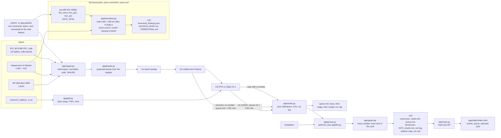

# Architecture

One command, two calculation paths, one output contract. `python -m app.pipeline` runs the space
funnel; adding `--terrestrial <3076.mdb> --terrestrial-prev <3075.mdb>` runs the terrestrial side
feature in the same pass, into the same `out/`, with the same `source` / `audit` / `missing` fields.
The deterministic path runs offline; the only optional step is card prose, and a numeric guard stands
between the model and the output.

## The pipeline

The web UI reads `out/` and nothing else. It runs no LLM call, opens no connection and does no
calculation: without `out/` the page still loads and the API answers 503 with the command to run.

## Modules

| Module | Responsibility |
|---|---|
| `app/config.py` | Static configuration: the seven space bands, the demo slice, the rules version, the adjacent-channel guard (`GUARD_MHZ`), the regulatory-stage table and the number formatting used in the documents. No channel frequency is hardcoded here; protected bands always come from the register. |
| `app/ingest.py` | Reads the 15 IFIC tables straight from the BR IFIC Access database with `mdb-export`, plus the Finnish register and the M4 allocation table. Normalises units ("3 520.500 MHz", "300k", "1.5 GHz"), keeps missing values as `None`, carries `notice.prov` (the regulatory stage) and `Station.directivity`, and hashes the input MDB with SHA256. Computes no gates. |
| `app/bands.py` | Derives the protected bands from the register rows that overlap one of the seven space allocations, merges overlapping and near bands, and lists which stations sit on them. |
| `app/pfd.py` | Geometry and the limit: slant range and elevation from GEO longitude or a non-GSO sweep, free-space loss, and the Article 21 Table 21-4 limit read from `rules/rr21_table21_4.csv`. No limit is hardcoded in code. |
| `app/gates.py` | The funnel G1 to G4: band overlap (with an optional adjacent-channel guard), visibility from Finland, the PFD computation and the class (`exceeds` / `near` / `clear`, an adjacent case capped at `near`), plus the reason code for every drop and the queue ordered by class, then regulatory stage, then margin. |
| `app/cards.py` | Builds the case card (source rows, calculation, M4 lookup, missing fields, one question), renders the Markdown, the queue, the CSV and the run log, and writes the output files — including one letter per `exceeds` case under `letters/`. |
| `app/pipeline.py` | The CLI: one BR IFIC `.mdb` in, the output files out. Add `--terrestrial <3076.mdb> --terrestrial-prev <3075.mdb>` and the same run also writes the terrestrial side feature into the same `out/`; without the flags the space run is unchanged. The deterministic path never touches the network; the optional prose step calls the endpoint in `LLM_BASE_URL` through `app/llm.py`. |
| `app/prose.py` | Card prose. The LLM drafts it, the guard checks it, the deterministic template in `templates/` is the floor. Also holds the correspondence-letter template and function. |
| `app/guard.py` | Numeric guard: scans the prose for numbers and rejects a sentence that carries a number the card does not have. |
| `app/llm.py` | The single OpenAI-compatible chat call. The endpoint and key come from `.env` (`LLM_BASE_URL`, `LLM_API_KEY`), never from code. The model runs wherever that URL points: the OpenShift AI sandbox in the Red Hat setup, another endpoint, or nowhere at all when the variable is unset. |
| `app/terrestrial.py` | The side path, run by the same command: reads two real BR IFIC terrestrial MDBs (3075 and 3076) with the same `mdb-export` reader `app/ingest.py` uses, takes each notice's change from the `intent` field, keeps land-mobile notices within 1 000 km of Finland that overlap the register, and computes ITU-R P.1546-6 field strength at points on the border line (the land borders with Sweden, Norway and Russia plus the outer limit of the territorial sea). It shares `app.ingest`'s provenance (`sha256`, `input_digest`) and `app.config.RULES_VERSION`, imports nothing from `app.gates` or `app.pfd`, and writes its own three files in the same `out/` with the same `source` / `audit` / `missing` contract as a card. |
| `app/main.py` | Read-only FastAPI app: six endpoints (`/`, `/health`, `/api/funnel`, `/api/cases`, `/api/cases/{id}`, `/api/queue`) over the files in `out/`, plus the one page. `KAISTA_OUT` points it at another output directory. |

Data flow goes one way. Nothing in the UI writes, and the deterministic path never reads the network.
The prose model is the one piece that can run outside the laptop: with `LLM_BASE_URL` set to the
served Granite in OpenShift AI, `app/llm.py` sends one chat call per card to the cluster, and the
guard still decides what reaches the output. Unset it and the run is local and offline.

Back to the documentation index in [README.md](../README.md#documentation).
